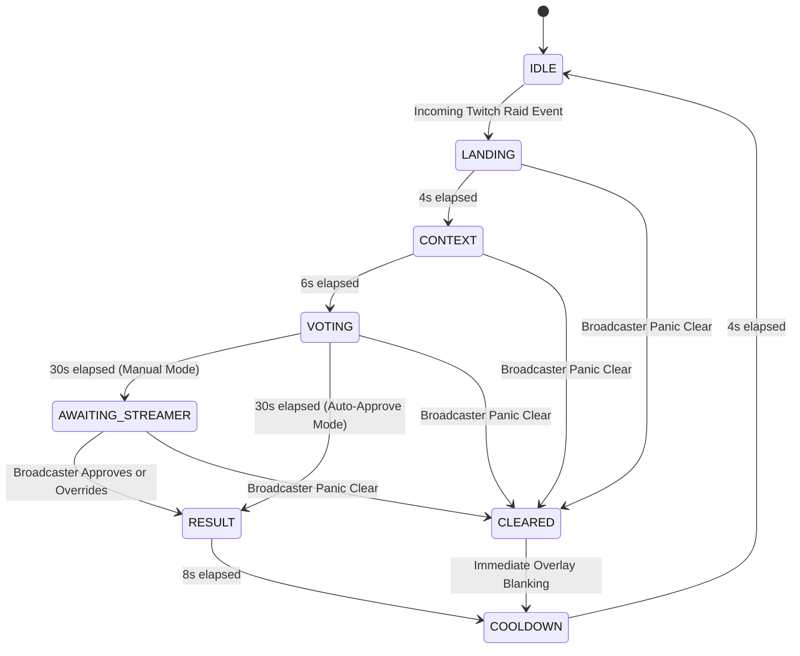

# RaidRelay — Technical Architecture & Specifications

## 1. Architectural Philosophy

RaidRelay is designed specifically for broadcast-critical environments. A streamer's on-screen overlay cannot crash, flicker, desynchronize, or expose secrets during a high-stakes raid event with hundreds or thousands of concurrent viewers.

The system is architected around four core principles:
1. **Server-Authoritative State:** Clients (OBS overlays and consoles) are purely reactive viewports. All timers, transitions, vote tallies, and tie-breaking algorithms execute deterministically on the server.
2. **Zero Arbitrary Chat Injection:** Streamers face constant harassment and hate-raid risks. RaidRelay never renders free-form chat on screen. Only binary vote commands (`!relay A` / `!relay B`) are counted into sanitized numeric meters.
3. **Tamper-Evident Receipts & Voter Privacy:** Viewers' raw Twitch IDs are never retained or broadcasted. Ephemeral voter hashes prevent duplicate voting without sacrificing privacy.
4. **Resilient Fail-Safe Defaults:** If Twitch Helix chat fails, the overlay continues. If network sockets disconnect, reconnection backoff preserves ritual state. Streamer panic clear halts all overlays in under 50ms.

---

## 2. Monorepo Package Topology

```text
raidrelay/
├── apps/
│   ├── server/             # Fastify backend, WebSocket hub, Twitch EventSub & Helix clients, SQLite repository
│   └── web/                # React 18, Vite, Tailwind CSS broadcast styling, OBS overlay, Broadcaster Console, Demo Lab
├── packages/
│   ├── contracts/          # Zod schemas, TypeScript types, and shared event interfaces
│   ├── domain/             # Server-authoritative RaidRitualEngine, HMAC crypto utilities, sanitize functions
│   └── fixtures/           # Championship Scenario (RoboCrafterLive) & deterministic simulation test fixtures
├── tests/
│   ├── unit/               # Domain state machine, invariant, and cryptographic unit tests
│   ├── integration/        # Server REST endpoints, WebSocket events, and EventGuard security tests
│   └── e2e/                # Playwright journeys across Desktop (1440px) and Mobile (390px) viewports + Axe accessibility
├── scripts/
│   ├── security-scan.ts    # Automated secret, token, and .env repository scanner
│   ├── check-claims.ts     # Truthfulness and marketing hyperbole linter
│   └── capture-screenshots.ts # Automated HiDPI screenshot pipeline
```

---

## 3. The 5-Phase Raid Ritual State Machine

The ritual advances through 5 deterministic server states:



### Invariants Enforced by `RaidRitualEngine`:
- **1-Person = 1-Vote:** `voterHash = HMAC_SHA256(userId, HMAC_VOTER_SALT)`. A voter hash can only increment the tally once per ritual ID. Subsequent votes are dropped silently.
- **Deterministic Tie-Breaking:** In the event of an exact vote tie (e.g. 50% vs 50%), the engine deterministically selects Option A to avoid deadlocks.
- **Auto-Approve vs Manual Flight Control:** Streamers can enable auto-approval in settings, allowing the majority vote to immediately crown the winner without taking hands off their game controller or keyboard.
- **Emergency Clear:** The `CLEAR` action functions from any active phase, resetting the overlay to clean transparent idle within 50ms.

---

## 4. WebSocket Real-Time Broadcasting (`/realtime`)

The backend RealtimeHub manages connections using native Fastify WebSocket integration:
- **Sequence Numbers:** Every broadcasted snapshot includes a strictly incrementing sequence number, enabling clients to discard out-of-order frames.
- **Channel-Key Scoping:** Overlay instances only receive updates matching their unguessable `channelKey`.
- **Initial Sync:** When an OBS overlay connects or reloads mid-ritual, the server immediately pushes the current active snapshot, preventing blank screens or desynchronization.
- **Source Mode Integrity:** Every snapshot carries a `sourceMode` property (`LIVE_TWITCH` vs `SIMULATED`), which the client UI uses to render honest provenance badges.

